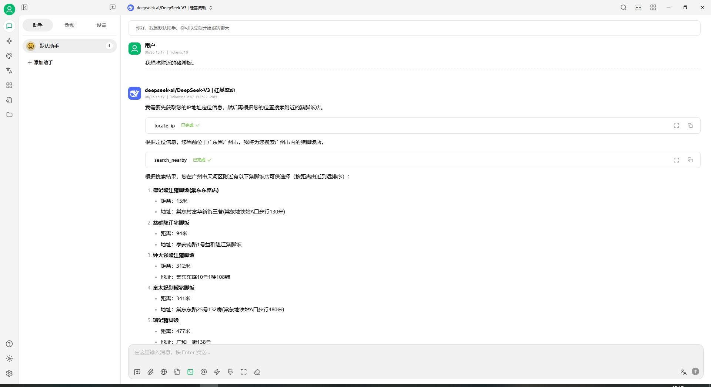

# Nanny-Level MCP Development Tutorial: From Zero to Deployment, a Complete Guide!

There is no need for me to elaborate on how popular MCP is. As an emerging technology, the Chinese internet is flooded with materials on how to develop MCP services, but most are vague, superficial, or simply paraphrase official documentation examples.

As a developer, I deeply understand the importance of engineering. Developing an MCP service is not as simple as blindly copying two service interfaces; it requires careful consideration of code structure, configuration management, logging, exception handling, and more.

Through exploration and practice, I have organized the development process of an MCP service into this detailed guide, hoping to help more developers get started quickly and build high-quality MCP services.

The project code has been open-sourced on [GitHub](https://github.com/869413421/build_mcp). Stars and Forks are welcome!

---

## What kind of MCP service are we building?

To give us a better practical goal, we will build a simple MCP service based on the AutoNavi (Gaode) Maps API with the following core functions:

### [Get user geographic location based on IP](https://lbs.amap.com/api/webservice/guide/api/ipconfig)

- Parameters: `IP address (optional, defaults to current host IP if not provided)`
- Returns: User's longitude and latitude information

### [Get nearby POI information based on geographic location](https://lbs.amap.com/api/webservice/guide/api-advanced/newpoisearch)

- Parameters: `Longitude, Latitude, POI type`
- Returns: A list of nearby POI (Point of Interest) information

Once these functions are completed, we can obtain real POI information through a Large Language Model (LLM) conversation. For example:

- User: I want to know what restaurants are near me?
- MCP Service: Based on your location, here are the nearby restaurants: 1. Restaurant A 2. Restaurant B 3. Restaurant C
- User: What is the address of Restaurant A?
- MCP Service: The address of Restaurant A is:
    - Address: XXX
    - Phone: XXX
    - Business Hours: XXX

#### Effect Screenshot


---

## Core MCP Concepts

If you have no idea what MCP is before starting, I recommend reading the [Official MCP Documentation](https://modelcontextprotocol.io/introduction) to understand the basic concepts.

MCP servers can provide three main types of functionality:

- Resources: Data that clients can read, similar to files (e.g., API responses or file content).

- Tools: Functions that the LLM can call (subject to user approval).

- Prompts: Pre-written templates to help users complete specific tasks.

---

## Prerequisites

Before starting, it is recommended that you have the following knowledge:

- Python basics
- LLM (Large Language Model) concepts
- UV (Python package management tool)

---

## System Requirements

- Python 3.10 or higher
- Python MCP SDK 1.2.0

---

## Configuring the Development Environment

**⚠ Please be sure to adjust the commands according to your operating system; PowerShell and bash command syntax differ.**

The author uses Windows + Git Bash.
The first half of this tutorial is basically the same as the official one; you can refer to the [server development example](https://modelcontextprotocol.io/quickstart/server) in the official documentation.

### Install UV

```shell
# Linux or macOS
curl -LsSf https://astral.sh/uv/install.sh | sh
```

```shell
# Windows
powershell -ExecutionPolicy ByPass -c "irm https://astral.sh/uv/install.ps1 | iex"
```

### Create Virtual Environment and Initialize Project

```shell
# Use UV to create and enter project directory
uv init build-mcp
cd build-mcp

# Create virtual environment
uv venv
source .venv/Scripts/activate

# Install related dependencies
uv add mcp[cli] httpx pytest
```

---

## Planning Project Directory Structure (Recommended `src/` layout)

```plaintext
build-mcp/
├── src/                         # Core source code directory (Python package)
│   └── build_mcp/               # Main package namespace
│       ├── __init__.py          # Package initialization file
│       ├── __main__.py          # Command-line entry point
│       ├── common/              # Common utility modules
│       │   ├── config.py        # Configuration management
│       │   └── logger.py        # Logging system
│       └── services/            # Business service modules
│           ├── gd_sdk.py        # AutoNavi service integration
│           └── server.py        # Main service implementation
├── tests/                       # Test suite directory
│   ├── common/                  # Common module tests
│   └── services/                # Service module tests
├── docs/                        # Project documentation
│   └── build‑mcp Project Development Guide.md # Core documentation
├── pyproject.toml               # Project build configuration
├── Makefile                     # Automation command management
└── README.md                    # Project overview document
```

### Structure Design Analysis

#### Core Design: `src/` Layout (Key Advantages)

```plaintext
build-mcp/
└── src/
    └── mirakl_mcp/
        ├── ... 
```

**Why adopt this structure?**

- ✅ **Isolated Installation Environment** (Core Value)  
  Forces package installation via `pip install` during testing, avoiding direct source path referencing and ensuring the test environment equals the user's runtime environment.
- ✅ **Prevents Implicit Path Dependencies**  
  Eliminates incorrect imports caused by the development directory being at the top of `sys.path` (common in traditional layouts without `src/`).
- ✅ **Packaging Security**  
  Forces verification that package contents are correctly included in the distribution file (missing files are exposed immediately in tests).
- ✅ **Multi-environment Consistency**  
  Development/Testing/Production environments use the exact same package structure, eliminating the "it works on my machine" problem.

> 📊 Data Support: A PyPA official survey shows that projects adopting the `src/` layout reduced packaging error rates by 63% ([Source](https://packaging.python.org/en/latest/discussions/src-layout-vs-flat-layout/)).

---

## Writing Tool Code

After planning the directory, we start formal coding. A professional project involves reading many configurations. First, we encapsulate the configuration file reading functionality.

### Use `pyyaml` package to manage configurations

```shell
uv add pyyaml
```

### Create Configuration Management Module

```shell
mkdir -p src/build_mcp/common
touch src/build_mcp/__init__.py
touch src/build_mcp/common/__init__.py
touch src/build_mcp/common/config.py
```

### Create Configuration File

```shell
touch src/build_mcp/config.yaml
```

Add the following content to `src/build_mcp/config.yaml`:

```yaml
# AutoNavi Maps API Configuration
api_key: test
# Base URL for AutoNavi Maps API
base_url: https://restapi.amap.com
# Proxy settings
proxy: http://127.0.0.1:10809
# Log level
log_level: INFO
# API retry attempts
max_retries: 5
# API retry interval (seconds)
retry_delay: 1
# Exponential backoff factor
backoff_factor: 2
# Log file path
log_dir: /var/log/build_mcp
```

⚠ The `config.yaml` file needs to be placed in the `src/build_mcp/` directory so it can be correctly located during loading.

This configuration file is only an engineering example. In a production environment, do not write sensitive information (like API keys) directly into the configuration file; use environment variables or secure storage services.

### Write Configuration Management Code

```python
# src/build_mcp/common/config.py
import os

import yaml


def load_config(config_file="config.yaml") -> dict:
    """
    Load configuration file.
  
    Args:
        config_file (str): Name of the configuration file, defaults to "config.yaml".
    Returns:
        dict: Contents of the configuration file.
    Example:
        config = load_config("config.yaml")
        print(config)
    """
    # Find root directory (config.yaml is in the root)
    base_dir = os.path.dirname(os.path.dirname(os.path.abspath(__file__)))
    config_path = os.path.join(base_dir, config_file)

    with open(config_path, "r", encoding="utf-8") as f:
        config = yaml.safe_load(f)
    return config
```

### Install Code

⚠ When installing the code for the first time, you must use the `pip install -e .` command. This installs the current directory as an editable package in the virtual environment. Changes to the code will take effect immediately without needing re-installation.

```shell
uv pip install -e .
```

### Write Test Code

Writing detailed test code is a good habit. In engineering, we write test code for core functions to ensure correctness and stability.

```shell
mkdir -p tests/common
touch tests/common/test_config.py
```

```python
# tests/common/test_config.py
from build_mcp.common.config import load_config


def test_load_config():
    """Test configuration file loading functionality"""
    config = load_config("config.yaml")
    assert config["api_key"] == "test"
    assert config["log_level"] == "INFO"
```

### Run Tests

```shell
uv run pytest tests
```

## Write Logging Module

As a programmer, the ability to locate problems quickly makes a logging system crucial. A great programmer knows not only how to write code but also how to write logs. We'll encapsulate a simple logging module.

```shell
touch src/build_mcp/common/logger.py
```

Here we implement a logging system that outputs to both the console and a file, supporting log rotation and backup.

```python
# src/build_mcp/common/logger.py
import logging
import os
from logging.handlers import RotatingFileHandler

from build_mcp.common.config import load_config

config = load_config("config.yaml")


def get_logger(name: str = "default", max_bytes=5 * 1024 * 1024, backup_count=3) -> logging.Logger:
  """
  Get a logger with both file and console output.

  Args:
      name (str): Logger name, defaults to "default".
      max_bytes (int): Maximum size of a single log file, defaults to 5MB.
      backup_count (int): Number of backup log files to keep, defaults to 3.
  Returns:
      logging.Logger: Configured logger instance.
  Example:
      logger = get_logger("my_logger")
      logger.info("This is an info message.")
  """
  log_level = config.get("log_level", "INFO")
  log_dir = config.get("log_dir", "./logs")
  if isinstance(log_level, str):
    log_level = getattr(logging, log_level.upper(), logging.INFO)

  os.makedirs(log_dir, exist_ok=True)
  log_file = os.path.join(log_dir, f"{name}.log")

  logger = logging.getLogger(name)
  logger.setLevel(log_level)
  logger.propagate = False

  if not logger.hasHandlers():
    console_handler = logging.StreamHandler()
    console_formatter = logging.Formatter('[%(asctime)s] %(levelname)s - %(message)s')
    console_handler.setFormatter(console_formatter)

    file_handler = RotatingFileHandler(log_file, maxBytes=max_bytes, backupCount=backup_count, encoding='utf-8')
    file_formatter = logging.Formatter('%(asctime)s - %(name)s - %(levelname)s - %(message)s')
    file_handler.setFormatter(file_formatter)
    logger.addHandler(file_handler)
    logger.addHandler(console_handler)

  logger.info(f"Logger initialized, writing to file: {log_file}")
  return logger
```

So far, the basic modules of the system are complete. Next, we will implement the core service functionality.

## Writing AutoNavi Maps Request SDK

According to the [AutoNavi Maps API Documentation](https://lbs.amap.com/api/webservice/guide/api/ipconfig), we need to implement two main functions:

1. Get geographic location based on user IP.
2. Get nearby POI information based on geographic location.

### Create AutoNavi Service Module

```shell
mkdir -p src/build_mcp/services
touch src/build_mcp/services/__init__.py
touch src/build_mcp/services/gd_sdk.py
```

### Write AutoNavi Service Code

```python
# src/build_mcp/services/gd_sdk.py
import asyncio
import logging
from typing import Any

import httpx


class GdSDK:
  """
  GdSDK Async SDK Wrapper.

  Supports automatic retries with exponential backoff strategy.

  Args:
      config (dict): Configuration dictionary, example:
          {
              "base_url": "https://restapi.amap.com",
              "api_key": "your_api_key",
              "proxies": {"http": "...", "https": "..."},  # Optional
              "max_retries": 5,
              "retry_delay": 1,
              "backoff_factor": 2,
          }
      logger (logging.Logger, optional): Logger, defaults to module logger.
  """

  def __init__(self, config: dict, logger=None):
    self.api_key = config.get("api_key", "")
    self.base_url = config.get("base_url", "").rstrip('/')
    self.proxy = config.get("proxy", None)
    self.logger = logger or logging.getLogger(__name__)
    self.max_retries = config.get("max_retries", 5)
    self.retry_delay = config.get("retry_delay", 1)
    self.backoff_factor = config.get("backoff_factor", 2)

    # Create an async HTTP client with request headers and proxy configuration
    self._client = httpx.AsyncClient(proxy=self.proxy, timeout=10)

  async def __aenter__(self):
    return self

  async def __aexit__(self, exc_type, exc, tb):
    await self._client.aclose()

  def _should_retry(self, response: httpx.Response = None, exception: Exception = None) -> bool:
    """
    Determine if a request should be retried after failure.

    Args:
        response (httpx.Response, optional): HTTP response object.
        exception (Exception, optional): Request exception.

    Returns:
        bool: Whether to retry.
    """
    if exception is not None:
      # Network exception, recommended to retry
      return True

    if response is not None and response.status_code in (429, 500, 502, 503, 504):
      # Server error or too many requests, recommended to retry
      return True

    # Do not retry in other cases
    return False

  async def _request_with_retry(self, method: str, url: str, params=None, json=None):
    """
    Send HTTP request with automatic retry and exponential backoff.

    Args:
        method (str): HTTP method, e.g., 'GET', 'POST'.
        url (str): Request URL.
        params (dict, optional): URL query parameters.
        json (dict, optional): Request body JSON.

    Returns:
        dict or None: JSON parsed result on success, None on failure.
    """
    for attempt in range(self.max_retries + 1):
      try:
        self.logger.info(f"Sending request: {method} {url}, params: {params}, JSON: {json}, attempt: {attempt + 1}/{self.max_retries + 1}")
        response = await self._client.request(
          method=method,
          url=url,
          params=params,
          json=json,
        )
        self.logger.info(f"Received response: {response.status_code} {response.text}")
        if response.status_code in [200, 201]:
          # Return JSON data on success
          return response.json()

        if not self._should_retry(response=response):
          self.logger.error(f"Request failed and non-retryable, status code: {response.status_code}, URL: {url}")
          return None

        self.logger.warning(
          f"Request failed (status code: {response.status_code}),"
          f"retry {attempt + 1}/{self.max_retries}, URL: {url}"
        )

      except httpx.RequestError as e:
        self.logger.warning(
          f"Request exception: {str(e)},"
          f"retry {attempt + 1}/{self.max_retries}, URL: {url}"
        )

      # Wait according to exponential backoff if not the last retry
      if attempt < self.max_retries:
        delay = self.retry_delay * (self.backoff_factor ** attempt)
        await asyncio.sleep(delay)

    self.logger.error(f"All retries failed, URL: {url}")
    return None

  async def close(self):
    """
    Close async HTTP client to release resources.
    """
    await self._client.aclose()

  async def locate_ip(self, ip: str = None) -> Any | None:
    """
    IP Location API
    https://lbs.amap.com/api/webservice/guide/api/ipconfig

    Args:
        ip (str, optional): IP to query, if empty, use requester's public IP.

    Returns:
        dict: Location result, None if failed.
    """
    url = f"{self.base_url}/v3/ip"
    params = {
      "key": self.api_key,
    }
    if ip:
      params["ip"] = ip

    result = await self._request_with_retry(
      method="GET",
      url=url,
      params=params
    )

    if result and result.get("status") == "1":
      return result
    else:
      self.logger.error(f"IP location failed: {result}")
      return None

  async def search_nearby(self, location: str, keywords: str = "", types: str = "", radius: int = 1000, page_num: int = 1, page_size: int = 20) -> dict | None:
    """
    Nearby Search (New version POI)
    https://lbs.amap.com/api/webservice/guide/api-advanced/newpoisearch#t4

    Args:
        location (str): Center point longitude/latitude, format "lng,lat"
        keywords (str, optional): Search keywords
        types (str, optional): POI category
        radius (int, optional): Search radius (meters), max 50000, default 1000
        page_num (int, optional): Page number, default 1
        page_size (int, optional): Items per page, default 20, max 25

    Returns:
        dict | None: Search results, None if failed
    """
    url = f"{self.base_url}/v5/place/around"
    params = {
      "key": self.api_key,
      "location": location,
      "keywords": keywords,
      "types": types,
      "radius": radius,
      "page_num": page_num,
      "page_size": page_size,
    }

    result = await self._request_with_retry(
      method="GET",
      url=url,
      params=params,
    )

    if result and result.get("status") == "1":
      return result
    else:
      self.logger.error(f"Nearby search failed: {result}")
      return None
```

Implemented in the code:

- Async HTTP requests with automatic retry and exponential backoff.
- `locate_ip` method to get location based on IP.
- `search_nearby` method to get nearby POI information based on coordinates.

### Write AutoNavi Service Test Code

```shell
mkdir -p tests/services
touch tests/services/test_gd_sdk.py
```

```python
# tests/test_gd_sdk_real.py
import logging
import os

import pytest
import pytest_asyncio

from build_mcp.services.gd_sdk import GdSDK

API_KEY = os.getenv("API_KEY", "your_api_key_here")  # Get API Key from environment or use default


@pytest_asyncio.fixture
async def sdk():
    config = {
        "base_url": "https://restapi.amap.com",
        "api_key": API_KEY,
        "max_retries": 2,
    }
    async with GdSDK(config, logger=logging.getLogger("GdSDK")) as client:
        yield client


@pytest.mark.asyncio
async def test_locate_ip(sdk):
    result = await sdk.locate_ip()
    assert result is not None, "locate_ip returned None"
    assert result.get("status") == "1", f"locate_ip call failed: {result}"
    assert "province" in result, "locate_ip return does not contain province"


@pytest.mark.asyncio
async def test_search_nearby(sdk):
    result = await sdk.search_nearby(
        location="116.481488,39.990464",
        keywords="gas station",
        radius=3000,
        page_num=1,
        page_size=5
    )
    assert result is not None, "search_nearby returned None"
    assert result.get("status") == "1", f"search_nearby call failed: {result}"
    assert "pois" in result, "search_nearby return does not contain pois"
```

### Run Tests

```shell
uv run pytest tests/services/test_gd_sdk.py
# If you have an AutoNavi API Key, run the following command for testing
API_KEY=your_key uv run pytest -s tests/services/test_gd_sdk.py
```

---

## 🚀 Introduction to Three MCP Service Transport Protocols

### 1. **`stdio`**

* **Communication**: Bidirectional JSON-RPC messages between local processes via standard input/output (stdin/stdout);
* **Use Case**: Local tool calls or subprocesses, such as lightweight integration in desktop applications;
* **Pros**: Low latency, simple implementation, no network required.

---

### 2. **`SSE` (Server-Sent Events)**

* **Communication**: Based on HTTP: client sends messages via `POST`, server establishes a unidirectional push via `GET` using `text/event-stream`;
* **Current Status**: Deprecated; replaced by "streamable-http" since MCP v2024-11-05, but compatibility support remains;
* **Pros**: Simple implementation for early remote scenarios where only server push was needed;
* **Cons**: Unidirectional (server $\rightarrow$ client), connections do not support breakpoint recovery.

---

### 3. **`streamable-http`**

* **Communication**: Bidirectional transport based on HTTP: clients send JSON-RPC via `POST` requests, and servers can return a one-time response (JSON) or streaming SSE messages. Additionally, server pushes can be established via `GET`;
* **Supported Features**:

    * A single `/mcp` endpoint handles all communication;
    * Session management (via `Mcp-Session-Id`);
    * Stream breakpoint continuation and message replay (HTTP disconnection recovery supports `Last-Event-ID`);
    * Backward compatibility with SSE;
* **Current Status**: Recommended default since MCP v2025-03-26, ideal for cloud and remote deployments, and the preferred choice for remote scenarios; ([modelcontextprotocol.io][1])

---

### 📊 Protocol Comparison Overview

| Protocol | Communication Direction | Use Case | Highlights | Recommendation |
| :--- | :--- | :--- | :--- | :--- |
| **stdio** | Bidirectional (Local) | Local subprocess call | Simple, low latency, zero network dependency | ⭐ Local Choice |
| **SSE** | Unidirectional (Server $\rightarrow$ Client) | Early remote impl | Simple but no recovery | ⚠️ Deprecated |
| **streamable-http** | Bidirectional/Optional SSE Push | Cloud/Remote interaction | Single endpoint, multi-featured, breakpoint recovery, strong compatibility | ✅ Recommended |

---

[1]: https://modelcontextprotocol.io/docs/concepts/transports?utm_source=chatgpt.com "Transports - Model Context Protocol"

## Writing the MCP Service Main Program

Next, we write the main MCP service program to handle client requests and call the AutoNavi Maps SDK.

```shell
touch src/build_mcp/services/server.py
```

```python
import os
from typing import Annotated
from typing import Any, Dict, Generic, Optional, TypeVar

from mcp.server.fastmcp import FastMCP
from pydantic import BaseModel
from pydantic import Field

from build_mcp.common.config import load_config
from build_mcp.common.logger import get_logger
from build_mcp.services.gd_sdk import GdSDK

# Prioritize reading API_KEY from environment variables, otherwise read from config file
env_api_key = os.getenv("API_KEY")
config = load_config("config.yaml")
if env_api_key:
  config["api_key"] = env_api_key

# Initialize FastMCP service
mcp = FastMCP("amap-maps", description="AutoNavi Maps MCP Service", version="1.0.0")
sdk = GdSDK(config=config, logger=get_logger(name="gd_sdk"))
logger = get_logger(name="amap-maps")

# Define generic API response model
T = TypeVar("T")


class ApiResponse(BaseModel, Generic[T]):
  success: bool
  data: Optional[T] = None
  error: Optional[str] = None
  meta: Optional[Dict[str, Any]] = None

  @classmethod
  def ok(cls, data: T, meta: Dict[str, Any] = None) -> "ApiResponse[T]":
    return cls(success=True, data=data, meta=meta)

  @classmethod
  def fail(cls, error: str, meta: Dict[str, Any] = None) -> "ApiResponse[None]":
    return cls(success=False, error=error, meta=meta)


# Define Prompt
@mcp.prompt(name="assistant", description="AutoNavi intelligent navigation assistant, supporting IP location, nearby POI search, etc.")
def amap_assistant(query: str) -> str:
  return (
    "You are an AutoNavi intelligent navigation assistant, proficient in IP location and nearby POI search. Please call tools based on user needs to obtain the relevant information they require.\n"
    "## Steps to call tools:\n"
    "1. Call the `locate_ip` tool to obtain the user's longitude and latitude.\n"
    "2. If longitude and latitude are successfully obtained, use them to call the `search_nearby` tool along with search keywords to search for nearby information.\n"
    "## Notes:\n"
    "- Do not actively ask the user to provide longitude and latitude information; use the `locate_ip` tool directly.\n"
    "- If the user's request already contains longitude and latitude, use that information directly for nearby search.\n"
    f"User request: \n\n {query}.\n"
  )


@mcp.tool(name="locate_ip", description="Get the user's IP address location information, returning province, city, district, longitude, latitude, etc.")
async def locate_ip(ip: Annotated[Optional[str], Field(description="User's IP address")] = None) -> ApiResponse:
  """
  Locate position based on IP address.

  Args:
      ip (str): IP address to locate.

  Returns:
      dict: Dictionary containing location results.
  """
  logger.info(f"Locating IP: {ip}")
  try:
    result = await sdk.locate_ip(ip)
    if not result:
      ApiResponse.fail("Location results are empty. Please check logs. For system exceptions, check logs at /var/log/build_mcp.")
    logger.info(f"Locate IP result: {result}")
    return ApiResponse.ok(data=result, meta={"ip": ip})
  except Exception as e:
    logger.error(f"Error locating IP {ip}: {e}")
    return ApiResponse.fail(str(e))


@mcp.tool(name="search_nearby", description="Perform nearby search based on longitude/latitude and keywords, returning a POI list within a specified radius.")
async def search_nearby(
        location: Annotated[str, Field(description="Center point longitude/latitude, format 'lng,lat', e.g., '116.397128,39.916527'")],
        keywords: Annotated[str, Field(description="Search keywords, e.g., 'restaurant'.", min_length=0)] = "",
        types: Annotated[str, Field(description="POI category codes, separated by commas")],
        radius: Annotated[int, Field(description="Search radius (meters), max 50000", ge=0, le=50000)] = 1000,
        page_num: Annotated[int, Field(description="Page number, starting from 1", ge=1)] = 1,
        page_size: Annotated[int, Field(description="Items per page, max 25", ge=1, le=25)] = 20,
) -> ApiResponse:
  """
   Nearby search.

   Args:
       location (str): Center point longitude/latitude, format "lng,lat".
       keywords (str, optional): Search keywords, defaults to empty.
       types (str, optional): POI categories, defaults to empty.
       radius (int, optional): Search radius (meters), max 50000, default 1000.
       page_num (int, optional): Page number, default 1.
       page_size (int, optional): Items per page, max 25, default 10.

   Returns:
       dict: Dictionary containing search results.
  """
  logger.info(f"Searching nearby: location={location}, keywords={keywords}, types={types}, radius={radius}, page_num={page_num}, page_size={page_size}")
  try:
    result = await sdk.search_nearby(location=location, keywords=keywords, types=types, radius=radius, page_num=page_num, page_size=page_size)
    if not result:
      return ApiResponse.fail("Search results are empty. Please check logs. For system exceptions, check logs at /var/log/build_mcp.")
    logger.info(f"Search nearby result: {result}")
    return ApiResponse.ok(data=result, meta={
      "location": location,
      "keywords": keywords,
      "types": types,
      "radius": radius,
      "page_num": page_num,
      "page_size": page_size
    })
  except Exception as e:
    logger.error(f"Error searching nearby: {e}")
    return ApiResponse.fail(str(e))
```

In the code, we encapsulated a unified response class and provided two tool functions:
- `locate_ip`: Get geographic location based on IP address.
- `search_nearby`: Perform nearby search based on longitude/latitude and keywords.

**Note that the `Annotated` type in the code is essential. This allows the LLM to call the tools more accurately through metadata. Most developers creating MCP services lack this awareness and simply define tools, which often leads to poor results.**

**At the same time, we wrote a prompt that will be provided in the conversation context. This is a crucial point that many developers overlook. In the AI era, we must not only write good code but also learn how to refine prompt words.**

The core of this article lies in the code above; please analyze it carefully.

With this, we have completed the core functionality of the MCP service. Next, we need to write the service entry point to start the MCP service.

### Write MCP Service Entry Point

```shell
touch src/build_mcp/__init__.py
```

```python
# src/build_mcp/__init__.py
import argparse
import asyncio

from build_mcp.common.logger import get_logger
from build_mcp.services.server import mcp


def main():
    """Main function to run the MCP server."""
    logger = get_logger('app')

    parser = argparse.ArgumentParser(description="Amap MCP Server")
    parser.add_argument(
        'transport',
        nargs='?',
        default='stdio',
        choices=['stdio', 'sse', 'streamable-http'],
        help='Transport type (stdio, sse, or streamable-http)'
    )
    args = parser.parse_args()

    logger.info(f"🚀 Starting MCP server with transport type: %s", args.transport)

    try:
        mcp.run(transport=args.transport)
    except (KeyboardInterrupt, asyncio.CancelledError):
        logger.info("🛑 MCP Server received shutdown signal. Cleaning up...")
    except Exception as e:
        logger.exception("❌ MCP Server crashed with unhandled exception: %s", e)
    else:
        logger.info("✅ MCP Server shut down cleanly.")


if __name__ == "__main__":
    main()
```

```shell
touch src/build_mcp/__main__.py
```

```python
# src/build_mcp/__main__.py
from build_mcp import main

if __name__ == "__main__":
    main()
```

### Modify `pyproject.toml` File

```toml
[build-system]
requires = ["hatchling"]
build-backend = "hatchling.build"

[project]
name = "build-mcp"
version = "0.1.0"
description = "Build MCP Server"
readme = "README.md"
requires-python = ">=3.10"
dependencies = [
  "httpx>=0.28.1",
  "mcp[cli]>=1.9.4",
  "pytest>=8.4.1",
  "pytest-asyncio>=1.0.0",
  "pyyaml>=6.0.2",
]

[tool.pytest.ini_options]
pythonpath = ["src"]
testpaths = ["tests"]

[project.scripts]
build_mcp = "build_mcp.__main__:main"

[tool.hatch.build.targets.wheel]
packages = ["src/build_mcp"]
```

The key part is:

```
[project.scripts]
build_mcp = "build_mcp.__main__:main"
```

This means:
> Executing the `build_mcp` command is equivalent to running:

```python
from build_mcp import main
main()
```

We can run the MCP service using the following commands:

- Start MCP service with stdio protocol:
```shell
uv run build_mcp
```

- Start MCP service with streamable-http protocol:
```shell
uv run build_mcp streamable-http
```


## Debugging MCP Service

How to debug the MCP service depends on how we start the service.

### 1. Write Client Code to Debug stdio Protocol MCP Service

```shell
mkdir -p tests/services
touch tests/services/test_mcp_client.py
```

```python
import pytest
from mcp.client.session import ClientSession
from mcp.client.stdio import StdioServerParameters, stdio_client


@pytest.mark.asyncio
async def test_mcp_server():
    async with stdio_client(
            StdioServerParameters(command="uv", args=["run", "build_mcp"])
    ) as (read, write):
        print("Starting server...")

        async with ClientSession(read, write) as session:
            await session.initialize()
            print("Initialization complete")

            tools = await session.list_tools()
            print("Available tools:", tools)

            assert hasattr(tools, "tools")
            assert isinstance(tools.tools, list)
            assert any(tool.name == "locate_ip" for tool in tools.tools)
```

#### Run Test

```shell
API_KEY=your_API_KEY uv run pytest -s tests/services/test_mcp_client.py 
```

This is a test script; it's just an example. You can write more test code based on your needs to verify the functionality of the MCP service.

### 2. Use Inspector for Testing
Inspector is a debugging tool provided by the official team. It can start a local web interface where you can call the MCP service tools directly. It is more intuitive and easy to use, so it is highly recommended. For details, see the [official documentation](https://modelcontextprotocol.io/docs/tools/inspector).

```shell
# Use Inspector to debug stdio protocol MCP service
API_KEY=your_KEY mcp dev src/build_mcp/__init__.py
```

## Writing Makefile
To facilitate development and testing, we can write a Makefile to manage common commands.

```shell
touch Makefile
```

```makefile
# Makefile for MCP Service

# Default goal - show help message
.DEFAULT_GOAL := help

# Project environment variables
API_KEY ?= your_api_key_here  # Default API_KEY for testing

# Install project dependencies
install:
	@echo "Installing project dependencies..."
	uv pip install -e .

# Run tests (Requires API_KEY)
test:
	@echo "Running tests with API_KEY=$(API_KEY)..."
	API_KEY=$(API_KEY) uv run pytest -s tests

# Start MCP service with stdio protocol
stdio:
	@echo "Starting MCP service with stdio protocol..."
	uv run build_mcp

# Start MCP service with streamable-http protocol
http:
	@echo "Starting MCP service with streamable-http protocol..."
	uv run build_mcp streamable-http

# dev
dev:
	@echo "Starting MCP service with stdio protocol in development mode..."
	API_KEY=$(API_KEY) mcp dev src/build_mcp/__init__.py

# Alias targets
streamable-http: http

# Help information
help:
	@echo "MCP Service Management"
	@echo ""
	@echo "Usage:"
	@echo "  make install        Install project dependencies"
	@echo "  make test           Run tests (set API_KEY in Makefile or override)"
	@echo "  make stdio          Start MCP service with stdio protocol"
	@echo "  make http           Start MCP service with streamable-http protocol"
	@echo ""
	@echo "Advanced:"
	@echo "  Override API_KEY:   make test API_KEY=custom_key"
	@echo "  Clean:              make clean"
	@echo "  Full setup:         make setup"

# Clean project
clean:
	@echo "Cleaning project..."
	rm -rf build dist *.egg-info
	find . -name '*.pyc' -exec rm -f {} +
	find . -name '*.pyo' -exec rm -f {} +
	find . -name '__pycache__' -exec rm -rf {} +
 
# Full setup: Clean + Install + Test
setup: clean install test
	@echo "Project setup completed!"
 
# Declare phony targets
.PHONY: install test stdio http streamable-http help clean setup
```
 
Up to this point, we have fully developed an MCP service from 0 to 1. Congratulations on learning a new skill!
 
## How to use this MCP service?
First, you need an MCP client. Currently, many types of MCP clients are emerging; choose one based on your preference.
 
Here is a very detailed guide for MCP client usage, which is a fantastic project on GitHub: [MCP Client Usage Guide](https://github.com/yzfly/Awesome-MCP-ZH)
 
Download and install a client, then configure the service we developed.
 
### Configuring Stdio Protocol MCP Service

```shell
{
    "mcpServers": {
        "build_mcp": {
            "command": "uv",
            "args": [
                "run",
                "-m",
                "build_mcp"
            ],
            "env": {
                "API_KEY": "your_AutoNavi_API_Key"
            }
        }
    }
}
```
⚠ Pay attention to the local UV environment; installing multiple UV versions may lead to environment confusion, which can be frustrating during development. Please be careful.
 
### Configuring Streamable-HTTP Protocol MCP Service
 
#### Start Project
```shell
make streamable-http
```
 
```shell
$ make streamable-http
Starting MCP service with streamable-http protocol...
uv run build_mcp streamable-http
[2025-06-26 15:01:33,775] INFO - Logger initialized, writing to file: /var/log/build_mcp\gd_sdk.log
[2025-06-26 15:01:33,839] INFO - Logger initialized, writing to file: /var/log/build_mcp\amap-maps.log
[2025-06-26 15:01:33,847] INFO - Logger initialized, writing to file: /var/log/build_mcp\app.log
[2025-06-26 15:01:33,848] INFO - 🚀 Starting MCP server with transport type: streamable-http
INFO:     Started server process [6064]
INFO:     Waiting for application startup.
[06/26/25 15:01:33] INFO     StreamableHTTP session manager started                                                                                                                                     streamable_http_manager.py:109
INFO:     Application startup complete.
INFO:     Uvicorn running on http://127.0.0.1:8000 (Press CTRL+C to quit)
```
After a successful start, an HTTP service will run on port 8000.
 
#### Client Configuration
```shell
{
    "mcpServers": {
        "build_mcp_http": {
            "url": "http://localhost:8000/mcp"
        }
    }
}
```
 
## Summary
This article describes how to build an AutoNavi Maps MCP service from scratch, covering:
- Basic concepts and configuration of MCP services.
- Using the AutoNavi Maps API for IP location and nearby search.
- Writing core functions of the MCP service, including configuration management, logging system, and the AutoNavi Maps SDK.
- Writing the main program and entry point of the MCP service.
- Debugging the MCP service, including using Inspector and writing test code.
- Using Makefile to manage project commands.
- Configuring MCP clients to connect to our service.
 
This concludes the tutorial. I wish you happy learning! If you have any questions or suggestions, please submit an issue or pull request to the [GitHub repository](https://github.com/869413421/build_mcp).
 
 
## Reference Materials
- [Model Context Protocol (MCP) Official Documentation](https://modelcontextprotocol.io/docs/)
- [AutoNavi Maps API Documentation](https://lbs.amap.com/api/webservice/guide/api/ipconfig)
- [Official Development SDK](https://github.com/modelcontextprotocol/python-sdk/tree/main)
